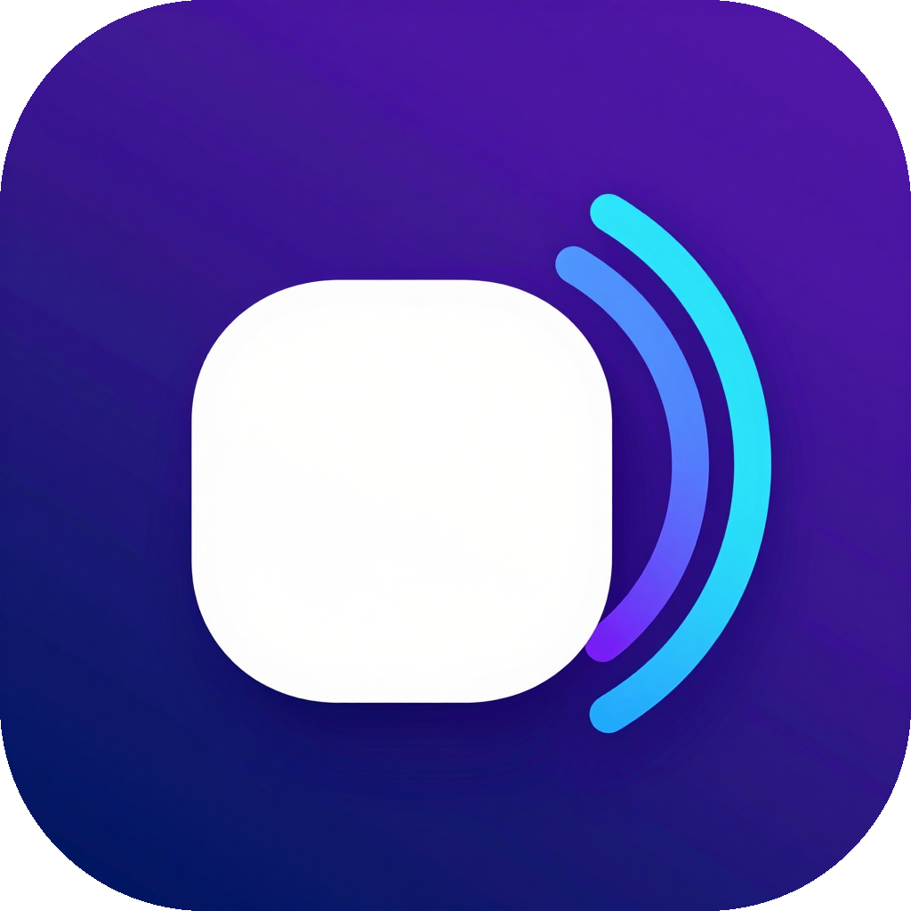

<p align="center">
  
</p>

<h1 align="center">SonosCast</h1>

<p align="center">Send your computer's sound to a Sonos speaker, as if it were plugged in.</p>

<p align="center">
  
</p>

SonosCast sends everything your computer plays (music, videos, games, browser tabs) to a Sonos speaker on your network. You pick a speaker and press play. You don't need any extra hardware, cables, or a Sonos account.

It comes in two forms:

- **A Windows app**, which is the window shown above.
- **A command-line version for macOS and Linux.** It also runs on Windows.

It was built and tested on a **Sonos Play:1**. It should work with other Sonos speakers too, because it uses the same local control API that every Sonos speaker exposes.

## Features

- **Finds your speakers automatically.** It discovers every Sonos speaker on your network and remembers the one you used last.
- **Streams all computer audio** in lossless 16-bit stereo, at your sound card's sample rate (44.1 or 48 kHz).
- **Adds very little delay on your computer.** Audio spends only tens of milliseconds there before it's sent, and the window shows that figure live as "PC buffer".
- **Lets you choose which audio output to capture**, if your PC has more than one.
- **Controls the speaker's volume** from the app.
- **Works with groups.** If the speaker is grouped in the Sonos app, the whole group plays.
- **Can start with Windows**, waiting in the system tray, and can **start playing automatically**.
- **Offers to fix Windows Firewall** for you if it is blocking the speaker.

## Windows app

### Download

Grab the latest version from the **[Releases page](https://github.com/Njordics/SonosCast/releases/latest)**:

| File | Use it if… |
| --- | --- |
| `SonosCast-<version>-win-x64-standalone.exe` (~50 MB) | You want it to just work. Nothing else needs to be installed. |
| `SonosCast-<version>-win-x64.exe` (~2 MB) | You already have the [.NET 9 Desktop Runtime](https://dotnet.microsoft.com/download/dotnet/9.0). |

SonosCast doesn't need installing. Put the `.exe` wherever you like and run it. It isn't code-signed, so Windows SmartScreen may warn you the first time. Click **More info**, then **Run anyway**.

### Use it

1. Open SonosCast. It searches for speakers and picks one.
2. Under **Capture from**, choose the output you normally listen through.
3. Press the big **play** button.
4. The first time, Windows may ask whether SonosCast can use the network. Allow it on **private networks**. If you missed that popup, SonosCast notices that the speaker can't connect, and offers to add the firewall rule for you.

Press the button again to stop. Closing the app also stops the speaker.

### Settings

Click the **gear** button in the top-right corner of the window:

- **Start with Windows**: SonosCast starts when you sign in and waits in the system tray. Opening it again brings the window back rather than starting a second copy.
- **Start playing when SonosCast opens**: it starts playing to the last speaker you used. Together with *Start with Windows*, this makes your Sonos behave like a speaker that's always plugged in. If the network is slow to come up after a reboot, it keeps looking for the speaker for a couple of minutes.

Settings are saved in `%AppData%\SonosCast\settings.json`.

## macOS and Linux (command line)

> The macOS and Linux versions are new. The shared streaming code is tested against a real Sonos speaker, but the platform-specific audio capture hasn't had much real-world use yet. Please [open an issue](https://github.com/Njordics/SonosCast/issues) if something doesn't work.

Download the `sonoscast-cli-<version>-<platform>.tar.gz` file for your system from the **[Releases page](https://github.com/Njordics/SonosCast/releases/latest)**, then unpack it:

```bash
tar -xzf sonoscast-cli-*.tar.gz
./sonoscast list                    # show the speakers on your network
./sonoscast play                    # stream to the first speaker found
./sonoscast play --speaker office   # …or pick one by name
```

Press **Ctrl+C** to stop. Run `./sonoscast --help` to see every option, including `stop` and `volume`.

| Platform | File |
| --- | --- |
| Linux (most PCs) | `linux-x64` |
| Linux on ARM (e.g. Raspberry Pi 4/5 with a 64-bit OS) | `linux-arm64` |
| Mac with Apple Silicon (M1 and later) | `osx-arm64` |
| Intel Mac | `osx-x64` |

### Linux setup

SonosCast records whatever your default output is playing, through PulseAudio or PipeWire. Most desktop Linux systems already have the tool it needs. If yours doesn't, install it:

```bash
sudo apt install pulseaudio-utils   # Debian / Ubuntu (provides parec)
sudo dnf install pulseaudio-utils   # Fedora
```

If you use a firewall, allow the speaker to connect to the stream: `sudo ufw allow 8930/tcp`.

### macOS setup

macOS can't record its own sound output without help, so SonosCast uses the free [BlackHole](https://github.com/ExistentialAudio/BlackHole) driver to capture it:

```bash
brew install ffmpeg blackhole-2ch
```

1. Open **Audio MIDI Setup**, click **+**, then **Create Multi-Output Device**. Tick both your speakers or headphones **and** *BlackHole 2ch*.
2. In **System Settings → Sound → Output**, choose that Multi-Output Device.
3. Run `./sonoscast play`. Allow incoming connections if macOS asks.

If you only want sound from the Sonos, select just *BlackHole 2ch* as your output instead.

The first time you open the file, macOS may block it because it isn't from an identified developer. Right-click it and choose **Open**, or run `xattr -d com.apple.quarantine sonoscast`.

### Other audio sources

`--source` takes any command that writes raw 16-bit stereo audio to its output:

```bash
./sonoscast play --source "ffmpeg -loglevel error -i song.flac -f s16le -ac 2 -ar 48000 -"
some-tool | ./sonoscast play --source stdin --rate 44100
```

## Good to know

- **Any delay depends on your network.** On a good home network it's usually not noticeable. A weak Wi-Fi signal to the computer or the speaker can add some lag, and a wired connection gives the best results.
- **Your computer keeps playing sound locally.** SonosCast copies the audio rather than redirecting it. To hear it only on the Sonos, mute your computer. On Windows, you can instead install a virtual audio device such as [VB-CABLE](https://vb-audio.com/Cable/), set it as your output, and choose it under **Capture from**.
- If you change what the speaker is playing in the Sonos app, SonosCast stops streaming. Press stop and then play to bring it back.

## How it works

```
 computer audio ──► capture ──► 16-bit PCM ──► HTTP server (:8930/pc-audio.wav)
                                                             ▲
 SonosCast ── UPnP SetAVTransportURI + Play (port 1400) ──► Sonos ──┘ fetches the stream
```

The code is split into three projects:

| Project | What it is |
| --- | --- |
| [`src/SonosCast.Core`](src/SonosCast.Core) | Shared by both apps. [`Sonos.cs`](src/SonosCast.Core/Sonos.cs) finds speakers with SSDP, falling back to scanning the local subnet for port 1400, and controls them through their UPnP endpoints. [`WavStreamServer.cs`](src/SonosCast.Core/WavStreamServer.cs) serves the audio as an endless WAV stream. |
| [`src/SonosCast`](src/SonosCast) | The Windows app. It captures audio with WASAPI loopback using [NAudio](https://github.com/naudio/NAudio), and draws its window with custom WinForms controls. |
| [`src/SonosCast.Cli`](src/SonosCast.Cli) | The cross-platform command-line app. It captures audio with `parec`/`pw-record` on Linux, ffmpeg and BlackHole on macOS, or reads it from stdin. |

**Keeping the delay low.** Each speaker gets its own small queue on the computer. If a speaker falls more than 250 ms behind, the oldest audio is dropped, so delay can't build up over time. The socket send buffer is kept small for the same reason. When nothing is playing, the server sends exactly as much silence as real time demands, so the speaker never runs dry and drops the stream.

The app talks only to devices on your network. It never contacts the internet, except for the optional GitHub link in the settings menu.

## Build it yourself

You need the [.NET 9 SDK](https://dotnet.microsoft.com/download/dotnet/9.0).

```bash
git clone https://github.com/Njordics/SonosCast.git
cd SonosCast
dotnet build SonosCast.sln -c Release

# Windows app as a single .exe
dotnet publish src/SonosCast/SonosCast.csproj -c Release -r win-x64 --self-contained false -p:PublishSingleFile=true -o publish

# Command-line app (pick your platform: linux-x64, linux-arm64, osx-arm64, osx-x64, win-x64)
dotnet publish src/SonosCast.Cli/SonosCast.Cli.csproj -c Release -r linux-x64 --self-contained true -p:PublishSingleFile=true -o publish-cli
```

Build macOS binaries on a Mac. Apple Silicon Macs only run signed binaries, and .NET only adds the required (ad-hoc) signature when it builds on macOS.

GitHub Actions ([`.github/workflows/build.yml`](.github/workflows/build.yml)) builds everything on every push. Pushing a tag such as `v1.1.0` also attaches every download to that GitHub release.

## Artwork

The banner and app icon were generated locally with [ComfyUI](https://github.com/comfyanonymous/ComfyUI) through its web API, using the Z-Image Turbo model. They live in [`src/SonosCast/Assets`](src/SonosCast/Assets) and are built into the app.

To make your own versions, start ComfyUI and run [`art/comfy_gen.py`](art/comfy_gen.py):

```bash
python art/comfy_gen.py my_banner.png 1280 512 42 "your prompt here"
python art/comfy_gen.py my_icon.png 1024 1024 7 --cutout "your prompt here"   # --cutout removes the background
```

Then replace the files in `src/SonosCast/Assets/` and rebuild.

## Troubleshooting

| Problem | What to try |
| --- | --- |
| No speakers found | Make sure the computer and the speaker are on the same network or Wi-Fi, then press refresh. Guest Wi-Fi networks and VPNs often block discovery. |
| Status stays on "Connecting…" | A firewall is blocking the speaker. On Windows, accept SonosCast's firewall prompt, or run this in an **administrator** PowerShell: `netsh advfirewall firewall add rule name="SonosCast" dir=in action=allow program="C:\path\to\SonosCast.exe" enable=yes profile=private,domain`. On Linux or macOS, allow incoming TCP connections on port 8930. |
| "Port 8930 is in use" | Another copy of SonosCast (possibly an older version) is still running. Close it from the system tray. |
| Status says "Live" but you hear nothing | Check that **Capture from** matches the output your audio actually plays through, and that the speaker's volume isn't 0. On macOS, make sure your sound output includes BlackHole. |
| Sound cuts out | Use a wired connection for the computer if you can. Weak Wi-Fi to the speaker can interrupt the stream. |

## Contributing

Issues and pull requests are welcome. Ideas: MP3 or FLAC streaming, a graphical app for macOS and Linux, or packages for Homebrew and the Linux distributions.

## License

[MIT](LICENSE). You're free to use, modify and share this software, including in commercial projects. Just keep the copyright notice.

*SonosCast is an independent project and is not affiliated with or endorsed by Sonos, Inc.*
