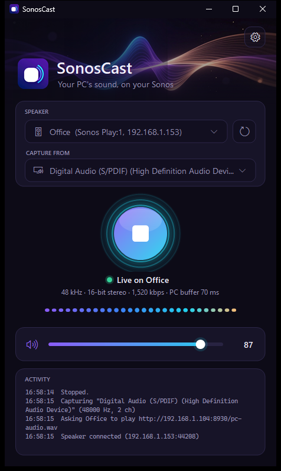

<p align="center">
  
</p>

<h1 align="center">SonosCast</h1>

<p align="center">Send your PC's sound to a Sonos speaker, as if it were plugged in.</p>

<p align="center">
  
</p>

SonosCast is a small Windows app that sends everything your PC plays (music, videos, games, browser tabs) to a Sonos speaker on your network. You pick a speaker and press play. You don't need any extra hardware, cables, or a Sonos account.

It was built and tested on a **Sonos Play:1**. It should work with other Sonos speakers too, because it uses the same local control API that every Sonos speaker exposes.

## Features

- **Finds your speakers automatically.** It discovers every Sonos speaker on your network and remembers the one you used last.
- **Streams all PC audio** in lossless 16-bit stereo, at your sound card's sample rate (44.1 or 48 kHz).
- **Lets you choose which audio output to capture**, if your PC has more than one.
- **Controls the speaker's volume** from the app.
- **Works with groups.** If the speaker is grouped in the Sonos app, the whole group plays.
- **Shows a live status line and level meter**, so you can see that audio is flowing.
- **Stays in the system tray** when minimised.
- **Offers to fix Windows Firewall** for you if it is blocking the speaker.

## Requirements

- Windows 10 or 11
- [.NET 9 Desktop Runtime](https://dotnet.microsoft.com/download/dotnet/9.0), unless you use the standalone download
- A Sonos speaker on the **same network** as your PC

## Getting started

### Download

Grab the latest version from the **[Releases page](https://github.com/Njordics/SonosCast/releases/latest)**:

| File | Use it if… |
| --- | --- |
| `SonosCast-<version>-win-x64-standalone.exe` (~50 MB) | You want it to just work. Nothing else needs to be installed. |
| `SonosCast-<version>-win-x64.exe` (~2 MB) | You already have the [.NET 9 Desktop Runtime](https://dotnet.microsoft.com/download/dotnet/9.0). |

SonosCast doesn't need installing. Put the `.exe` wherever you like and run it. It isn't code-signed, so Windows SmartScreen may warn you the first time. Click **More info**, then **Run anyway**.

### Build it yourself

You need the [.NET 9 SDK](https://dotnet.microsoft.com/download/dotnet/9.0).

```powershell
git clone https://github.com/Njordics/SonosCast.git
cd SonosCast
dotnet publish -c Release -r win-x64 --self-contained false -p:PublishSingleFile=true -o publish
```

Then run `publish\SonosCast.exe`.

For a larger `.exe` that runs without .NET installed, use `--self-contained true` instead.

### Use it

1. Open SonosCast. It searches for speakers and picks one.
2. Under **Capture from**, choose the PC output you normally listen through.
3. Press the big **play** button.
4. The first time, Windows may ask whether SonosCast can use the network. Allow it on **private networks**. If you missed that popup, SonosCast notices that the speaker can't connect, and offers to add the firewall rule for you.

Press the button again to stop. Closing the app also stops the speaker.

## Good to know

- **Any delay depends on your network.** On a good home network it's usually not noticeable. A weak Wi-Fi signal to the PC or the speaker can add some lag, and a wired connection gives the best results.
- **Your PC keeps playing sound locally.** SonosCast copies the audio rather than redirecting it. To hear it only on the Sonos, mute your PC speakers or headphones. Alternatively, install a virtual audio device such as [VB-CABLE](https://vb-audio.com/Cable/), set it as your Windows output, and choose it under **Capture from**.
- If you change what the speaker is playing in the Sonos app, SonosCast stops streaming. Press stop and then play to bring it back.

## How it works

```
 PC audio ──► WASAPI loopback capture ──► 16-bit PCM ──► HTTP server (:8930/pc-audio.wav)
                                                                    ▲
 SonosCast ── UPnP SetAVTransportURI + Play (port 1400) ──► Sonos ──┘ fetches the stream
```

1. **Capture.** [`AudioStreamer.cs`](AudioStreamer.cs) records the mix of the chosen Windows output with WASAPI loopback, using [NAudio](https://github.com/naudio/NAudio). It also plays inaudible silence on that output, so the stream keeps flowing when nothing is playing. Otherwise the Sonos would give up on it.
2. **Serve.** The same class runs a tiny HTTP server that sends the audio as an endless WAV stream.
3. **Control.** [`Sonos.cs`](Sonos.cs) finds speakers with SSDP, and falls back to scanning the local subnet for port 1400. It then uses the speaker's UPnP endpoints to point it at the stream, press play, and read or set the volume. Commands go to the group coordinator, so grouped speakers play along.
4. **UI.** [`MainForm.cs`](MainForm.cs) and [`Ui.cs`](Ui.cs) draw the window with custom WinForms controls.

The app talks only to devices on your network. It never contacts the internet.

## Artwork

The banner and app icon were generated locally with [ComfyUI](https://github.com/comfyanonymous/ComfyUI) through its web API, using the Z-Image Turbo model. The app icon is `Assets/icon.png`, `Assets/app.ico` is the same icon in Windows .ico format, and the banner is `Assets/banner.jpg`. All three are built into the app.

To make your own versions, start ComfyUI and run [`art/comfy_gen.py`](art/comfy_gen.py):

```powershell
python art/comfy_gen.py my_banner.png 1280 512 42 "your prompt here"
python art/comfy_gen.py my_icon.png 1024 1024 7 --cutout "your prompt here"   # --cutout removes the background
```

Then replace the files in `Assets/` and rebuild.

## Troubleshooting

| Problem | What to try |
| --- | --- |
| No speakers found | Make sure the PC and the speaker are on the same network or Wi-Fi, then press refresh. Guest Wi-Fi networks and VPNs often block discovery. |
| Status stays on "Connecting…" | Windows Firewall is blocking the speaker. Accept SonosCast's firewall prompt, or run this in an **administrator** PowerShell: `netsh advfirewall firewall add rule name="SonosCast" dir=in action=allow program="C:\path\to\SonosCast.exe" enable=yes profile=private,domain` |
| Status says "Live" but you hear nothing | Check that **Capture from** matches the output your audio actually plays through, and that the speaker's volume isn't 0. |
| Sound cuts out | Use a wired connection for the PC if you can. Weak Wi-Fi to the speaker can interrupt the stream. |

## Contributing

Issues and pull requests are welcome. Ideas: MP3 or FLAC streaming, lower-latency tuning, a "start with Windows" option, or a macOS or Linux version.

## License

[MIT](LICENSE). You're free to use, modify and share this software, including in commercial projects. Just keep the copyright notice.

*SonosCast is an independent project and is not affiliated with or endorsed by Sonos, Inc.*
